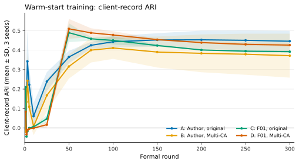
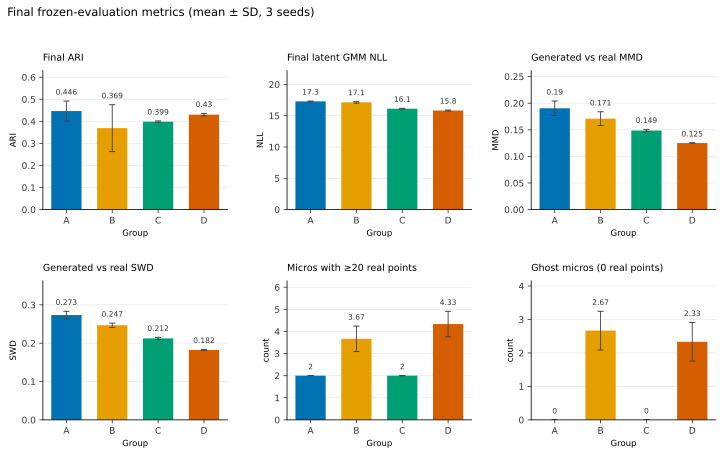

# FedVaDE + Multi-CA 2×2 Warm-Start Report

**Status:** 12/12 runs completed; 300 formal rounds each; no pretraining; no zero-start baseline.

## 1. Mandatory limitation: server-only source weights

The author-delivered `server_model_breast_cancer.pk` and the F01
`epoch_100_server.pt` contain **server weights only**. They do not contain
client models, local GMMs, optimizers, schedulers, or RNG states. Exact
continuation of the historical federated trajectories is impossible.

This experiment therefore uses a deterministic warm start: the server
encoder/decoder and GMM are loaded; each client encoder/decoder is copied
from the server; each local GMM is initialized by selecting the top
local-class-count components of the same server GMM. No local GMM is
fitted and no pretraining is run. **A/B and C/D are new warm-start runs,
not reproductions of the historical author/F01 client trajectories.**

## 2. Initial model verification

| Model | Historical ARI | Initial current ARI | Source |
|---|---:|---:|---|
| AUTHOR | 0.6395 | 0.6317 | `server_model_breast_cancer.pk` |
| F01 | 0.6140 | 0.6090 | `epoch_100_server.pt` |

These initial numbers are author-protocol in-sample metrics; BC has no
independent test split. Historical values are references, not guarantees.

## 3. Design

| Group | Initial server | Multi-CA | Server GMM |
|---|---|---|---|
| A | author warm start | OFF | K=2, author ELBO update |
| B | same author warm start | ON | K_micro=10, Multi-CA aggregation every round |
| C | F01 epoch-100 warm start | OFF | K=2, author ELBO update |
| D | same F01 warm start | ON | K_micro=10, Multi-CA aggregation every round |

OFF is the author training loop with `gmm_sampling`. ON builds a true
Macro–Micro hierarchy (`K_macro=2`, `K_micro=10`, micros retained) from the
current client local GMMs every round, samples it for server training, and
replaces the server GMM with that aggregation. The ON server optimizer trains
encoder/decoder only; the GMM is supplied by Multi-CA, so it cannot collapse
back to a K=2 gradient solution. OFF and ON share identical client states,
encoder/decoder initialization, data order, and seed.

`K_micro=10` was selected label-free by BIC on the initial real latents
(both models selected 10). No test labels were used for capacity or merging.

## 4. Final results (mean ± SD over seeds 0,1,2)

| Group | Final ARI | Final Purity | Final NMI | NLL | Gen MMD | Gen SWD | K_micro | Support≥20 | Ghost | Mass<20 support |
|---|---:|---:|---:|---:|---:|---:|---:|---:|---:|---:|
| A | 0.4464 ± 0.0456 | 0.8339 ± 0.0169 | 0.3853 ± 0.0356 | 17.2844 ± 0.0622 | 0.1904 ± 0.0136 | 0.2733 ± 0.0099 | 2.0 | 2.0 | 0.0 | 0.0000 |
| B | 0.3692 ± 0.1062 | 0.8021 ± 0.0423 | 0.3511 ± 0.0689 | 17.1360 ± 0.1180 | 0.1709 ± 0.0129 | 0.2468 ± 0.0056 | 10.0 | 3.7 | 2.7 | 0.5299 |
| C | 0.3985 ± 0.0033 | 0.8190 ± 0.0012 | 0.2875 ± 0.0027 | 16.1154 ± 0.0722 | 0.1487 ± 0.0021 | 0.2124 ± 0.0027 | 2.0 | 2.0 | 0.0 | 0.0000 |
| D | 0.4303 ± 0.0056 | 0.8307 ± 0.0020 | 0.3136 ± 0.0044 | 15.8263 ± 0.0784 | 0.1250 ± 0.0004 | 0.1824 ± 0.0014 | 10.0 | 4.3 | 2.3 | 0.4764 |

### Per-seed results

| Group | Seed | ARI | Purity | NMI | NLL | Gen MMD | Gen SWD | K_micro |
|---|---:|---:|---:|---:|---:|---:|---:|---:|
| A | 0 | 0.4115 | 0.8209 | 0.3597 | 17.2778 | 0.18120 | 0.26270 | 2.0 |
| A | 1 | 0.4298 | 0.8279 | 0.3702 | 17.3496 | 0.20608 | 0.27480 | 2.0 |
| A | 2 | 0.4980 | 0.8530 | 0.4260 | 17.2257 | 0.18398 | 0.28233 | 2.0 |
| B | 0 | 0.3197 | 0.7829 | 0.3199 | 17.1657 | 0.16518 | 0.24045 | 10.0 |
| B | 1 | 0.2968 | 0.7727 | 0.3033 | 17.2364 | 0.18568 | 0.24923 | 10.0 |
| B | 2 | 0.4911 | 0.8505 | 0.4301 | 17.0060 | 0.16180 | 0.25085 | 10.0 |
| C | 0 | 0.4018 | 0.8202 | 0.2897 | 16.1887 | 0.14618 | 0.20940 | 2.0 |
| C | 1 | 0.3985 | 0.8191 | 0.2882 | 16.0444 | 0.14976 | 0.21339 | 2.0 |
| C | 2 | 0.3952 | 0.8178 | 0.2845 | 16.1131 | 0.15002 | 0.21450 | 2.0 |
| D | 0 | 0.4367 | 0.8329 | 0.3187 | 15.9100 | 0.12477 | 0.18186 | 10.0 |
| D | 1 | 0.4276 | 0.8297 | 0.3116 | 15.7546 | 0.12548 | 0.18400 | 10.0 |
| D | 2 | 0.4265 | 0.8293 | 0.3106 | 15.8144 | 0.12488 | 0.18146 | 10.0 |

## 5. Paired effects

| Contrast | ΔARI | ΔPurity | ΔNMI | ΔNLL | ΔGen MMD | ΔGen SWD | ΔSupport≥20 | ΔGhost |
|---|---:|---:|---:|---:|---:|---:|---:|---:|
| B−A | -0.0772 ± 0.0643 | -0.0319 ± 0.0269 | -0.0342 ± 0.0359 | -0.1483 ± 0.0618 | -0.01954 ± 0.00317 | -0.02643 ± 0.00467 | 1.7 | 2.7 |
| D−C | 0.0318 ± 0.0029 | 0.0116 ± 0.0011 | 0.0261 ± 0.0028 | -0.2891 ± 0.0100 | -0.02361 ± 0.00196 | -0.02999 ± 0.00280 | 2.3 | 2.3 |

Negative ΔNLL/ΔMMD/ΔSWD is better. These are three paired seeds; no
significance test is claimed.

## 6. Initial-to-final degradation

| Group | Initial ARI | Final ARI | Δ (final−initial) |
|---|---:|---:|---:|
| A | 0.6317 | 0.4464 ± 0.0456 | -0.1853 |
| B | 0.5893 | 0.3692 ± 0.1062 | -0.2201 |
| C | 0.6090 | 0.3985 ± 0.0033 | -0.2105 |
| D | 0.6199 | 0.4303 ± 0.0056 | -0.1897 |

The warm start does **not** preserve the historical ARI: all groups drop
sharply in the first rounds, then partially recover. This is a property of
continuing a converged server with reinitialized client states at the
author/F01 learning rate, not a Multi-CA effect.

## 7. Micro retention

ON final server GMM (AUTHOR, group B) has K_micro=10.0, mean supported micros (≥20 real points)=3.7, mean ghost micros=2.7, mass on <20-support micros=0.530.
ON final server GMM (F01, group D) has K_micro=10.0, mean supported micros (≥20 real points)=4.3, mean ghost micros=2.3, mass on <20-support micros=0.476.

| Group | Bottom-quartile n | Bottom-Q mass | Bottom-Q MMD | Bottom-Q SWD | Mass<20 support |
|---|---:|---:|---:|---:|---:|
| A | 1.0 | 0.3370 | 0.22149 | 0.33590 | 0.0000 |
| B | 1.0 | 0.1021 | 0.31909 | 0.38457 | 0.5299 |
| C | 1.0 | 0.3087 | 0.33928 | 0.52198 | 0.0000 |
| D | 1.3 | 0.1375 | 0.27322 | 0.30377 | 0.4764 |

The low-mass threshold 1/(2K_micro) yields no micros in these runs;
the bottom quartile is reported as an exploratory rare-mode proxy.
These are model-defined low-weight micros, not ground-truth rare
clinical modes. BC has only two classes, so no true client-specific
rare-mode validation is possible.

The ON parameterization retains K_micro=10 and the training log shows
roughly nine effective components, but only a subset of micros receives
broad real support; several ghosts remain and roughly half of the ON
probability mass falls on <20-support micros. This is a **partial**
micro-retention result, not evidence of broad meaningful micro retention.

## 8. Answers to the requested comparisons

- **B−A (author ON−OFF):** the paired ARI effect is negative on average
  (≈−0.077), while NLL and generation MMD/SWD improve consistently
  (ΔNLL ≈−0.148, ΔMMD ≈−0.020, ΔSWD ≈−0.026). The ARI loss is largest in
  seeds 0/1; seed 2 is essentially flat. This is a model-dependent trade-off.
- **D−C (F01 ON−OFF):** the paired ARI effect is positive on average
  (≈+0.032), and NLL/MMD/SWD also improve (ΔNLL ≈−0.289, ΔMMD ≈−0.024,
  ΔSWD ≈−0.030). The direction is consistent across the three seeds, but
  this is still a three-seed, single-dataset result.
- **NLL/MMD/SWD:** Multi-CA ON is consistently better than OFF on density
  and generation metrics in both models, while ARI is model-dependent.
- **Micro retention:** K=10 capacity is present, with 3.7/4.3 supported
  micros and 2.7/2.3 ghosts on average; retention is partial, not broad.

## 9. Limitations

- Source weights are server-only; exact historical continuation is impossible.
- Warm-start client states are reconstructed, not recovered.
- BC has no independent test split; all metrics are in-sample.
- Three seeds only; no significance claim.
- B/D change capacity (K=2→10) as well as aggregation; B−A/D−C are not
  pure aggregation effects.
- The ON server GMM is supplied by Multi-CA every round and is not trained
  by the server ELBO; this is the explicit micro-preservation design.
- No true client-specific rare-mode labels exist in BC; rare/ghost evidence
  is preliminary.

## 10. Artifacts

- `results/per_seed.csv`, `group_mean_std.csv`, `paired_effects.csv`,
  `training_curve_mean.csv`, `integrity.json`
- `runs/*/rounds.jsonl`, `evaluation.json`, `config.json`; checkpoints remain
  on the server and are not uploaded.
- Monitor: `monitoring/remote_status.sh` and the Mac `.command`.
