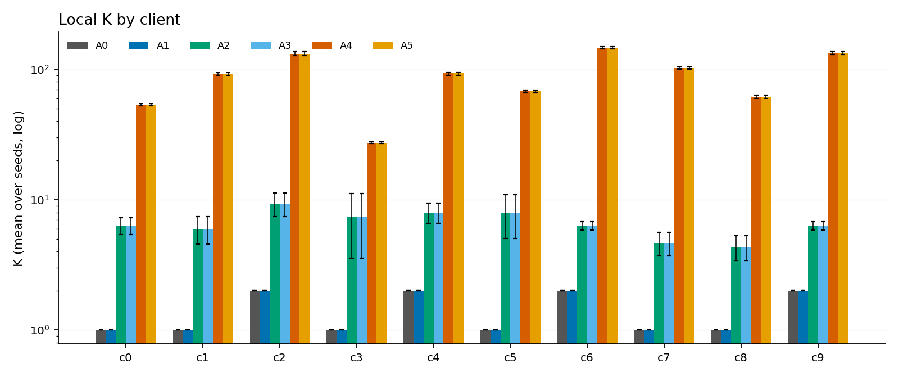
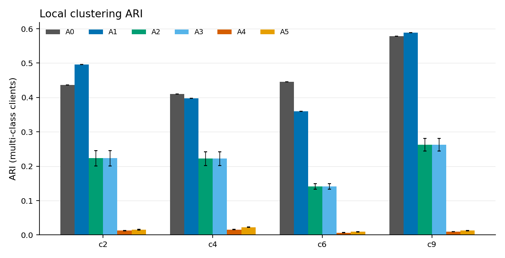
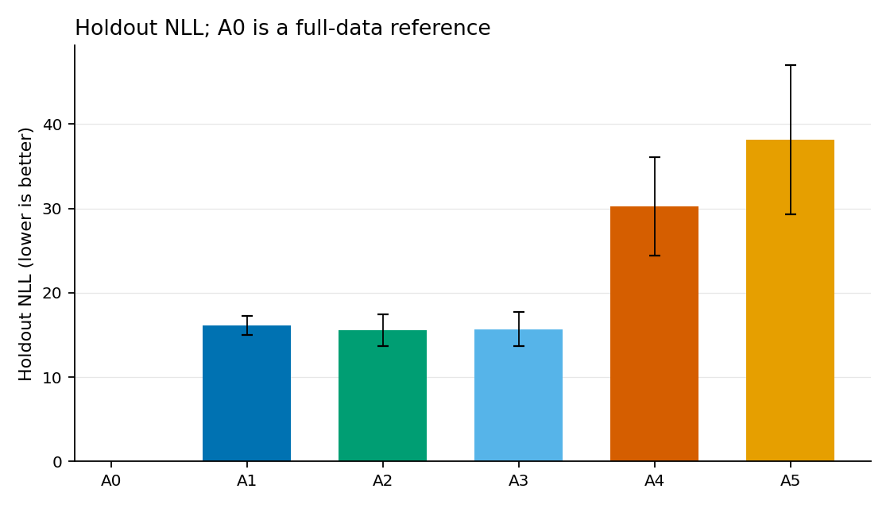
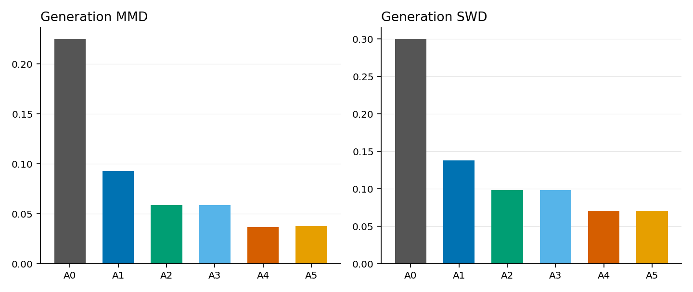
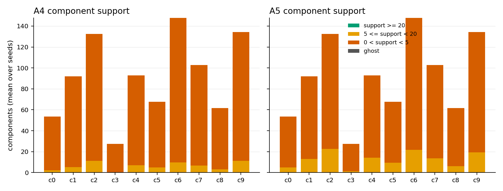
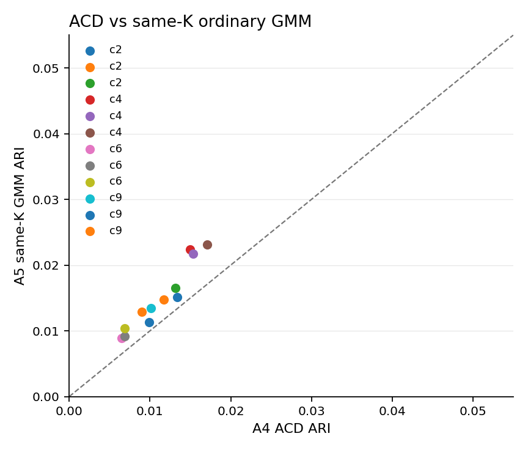
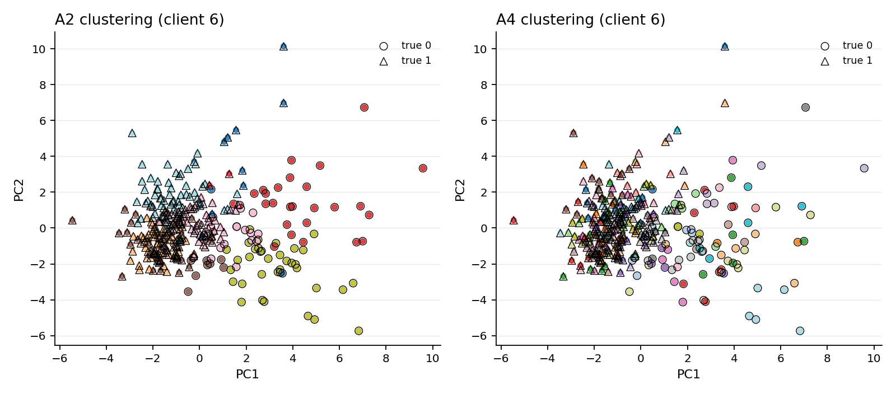

# F01 + ACD 冻结实验：ACD 与 Local GMM 参数转换

**状态：完成。** 仅使用冻结的 F01 第 100 轮完整 Checkpoint 做局部聚类拟合与生成评价；
未重新训练 FedVaDE、未重建客户端、未修改 Checkpoint、未引入 Fed-HIRE 的服务器 MHR。

## 1. 基础 Checkpoint 与数据

| 项 | 值 |
|---|---|
| Checkpoint | `reproduction_runs/round7_f01_full_repro/fine/F01/epoch_100_full.pt` |
| SHA256 | `3be341c451a186d1f36673080164af208993d215f0c2cb03709407892f7d6f3e` |
| 轮次 | 100 |
| 客户端 | 10 个真实 client；local K `[1,1,2,1,2,1,2,1,1,2]` |
| 数据 | 直接使用 Checkpoint 的 `partition` 张量；未重新划分、未重建客户端 |
| 类别 | 4 个客户端有 2 类（c2/c4/c6/c9），其余 6 个客户端只有 1 类 |

原始 ARI 0.6053 ± 0.0045（10 inference seeds）是 F01 全局指标；本实验评价的是
**每个客户端的 Local GMM**，不是全局 ARI 的直接复现。

## 2. ACD 来源与论文/源码差异

- 论文：*Stitch the Fragments: One-Shot Hierarchical Federated Clustering*，
  arXiv `2601.06404v2`；本地 PDF 已核对。
- 作者源码：`hongdream/Fed-HIRE`，pin commit
  `c116c8354f988d4c3080bbd9b1ab685117e78787`；ACD 对应
  `MultiClustering.py::FCPL` / `_batch_cpl`。
- 本地源码 SHA256：`2d49665775bdc0af91874a48c2533276dcf5a23086c1542f5db3b3578d0bfc49`。
- 本次**原样复制**作者 `MultiClustering.py` 到 `vendor/FedHIRE/`，未修改任何竞争机制；
  `rate=0.05`、`k0=0.5`、`MAX_ITER=100`，仅把 `random_state` 设为实验种子 0/1/2。

论文与源码存在明确差异，详见 `audit/ACD_SOURCE.md`：权重位移
（论文 `sigmoid(10(τ+5))` vs 源码 `sigmoid(10·belta-5)`）、奖励/惩罚粒度、
显式权重淘汰、初始化细节均不同。**A4 的结果是作者源码版本的结果，不是按论文公式
重写的 ACD；本次未做论文公式变体，也没有调参寻找正面结果。**

## 3. FedVaDE Local GMM 接口

原始 `pre_train` 在预训练后把 `encoder.log_sigma2_l` 权重复制为 `mu_l`，并断言
`mu == sigma`；随后用 **encoder 的均值 `mu`** 拟合
`GaussianMixture(covariance_type='diag', random_state=42)`。因此：

- 所有新方法使用 `z_i = encoder(x_i).mu`（10 维），不使用后验采样值，也不替换为其他特征。
- 参数：`pi (K,)`、`mu (K,10)`、`log_sigma2 (K,10)`；对角方差；`reg_covar=1e-6`；
  `rho = log(pi + 1e-10)`；`log_sigma2 = log(var)`。
- A4 使用 ACD 最终归属的样本计数估计：`pi_k=n_k/N`，`mu_k` 为簇均值，
  `var_k` 为 population 方差（`ddof=0`），并做 `max(var_k,1e-6)`；**不追加 EM**。
- A4 的 ACD 竞争权重 `belta` 没有作为 π；π 只来自最终样本计数。
- 单样本/低支持分量保留并标记，不静默删除或合并；空簇不产生参数。

**接口验证：** A4 的 full 30/30 与 holdout 30/30 参数均能装入该客户端 `VaDE`，
`load_state_dict(strict=True)`、`predict` 与 `decoder` 均有限、标签在 `[0,K)`；
无 NaN/Inf。详见 `audit/INTERFACE.md`。

## 4. 六组对照

| 组 | 方法 |
|---|---|
| A0 | F01 原始 Local GMM（Checkpoint 原样） |
| A1 | 原始 K + ordinary GaussianMixture 重拟合 |
| A2 | BIC 原始范围 + ordinary GMM |
| A3 | BIC 扩展范围 + ordinary GMM |
| A4 | 作者 ACD（FCPL）+ 矩估计 GMM，无 EM |
| A5 | 与 A4 **逐客户端、逐种子、逐 split 相同 K** 的 ordinary GMM |

- 所有方法使用相同 client encoder、`mu` 特征、拟合数据、评价数据与 seeds 0/1/2。
- 原始 BIC 范围：`2..min(14, n_fit//5)`；扩展范围：`2..min(30, n_fit//5)`；
  `n//5` 是预先固定的样本量约束，不按评价结果调整。原始上限 14 来自此前项目的
  `build_init.bic_select`（2..14）。
- 生成本地评价使用 **该客户端自己的冻结 Decoder**，不使用 Server Decoder；
  每客户端/方法/种子生成 2000 个样本，MMD/SWD 与 64 个方向对不同方法一致。
- 固定留出：每客户端 20%，split 种子 `20261125 + client_id`，不改变联邦划分，
  不使用标签分层；A1–A5 在 80% 上重新拟合，评价 20% 留出 NLL。
  A0 已使用完整本地数据，留出 NLL 仅作历史参考。

## 5. 主要结果

均值来自 10 clients × 3 seeds；ARI/NMI/Purity 的汇总只使用 4 个多类客户端
（c2/c4/c6/c9）；单类客户端的 ARI 对 K>1 退化为 0，不用于方法排序。

| 方法 | K mean (min–max) | ARI multi | NMI multi | Purity multi | Holdout NLL | Gen MMD | Gen SWD | 支持<5 分量 mean | π 在 <5 分量 | 跨种子稳定性 | A4 接口 |
|---|---:|---:|---:|---:|---:|---:|---:|---:|---:|---:|---|
| A0 | 1.4 (1–2) | 0.4675 | 0.3500 | 0.8451 | 17.2646* | 0.2253 | 0.3002 | 0.0 | 0.000 | 1.000 | — |
| A1 | 1.4 (1–2) | 0.4606 | 0.3521 | 0.8401 | 16.1006 | 0.0928 | 0.1382 | 0.0 | 0.000 | 1.000 | — |
| A2 | 6.7 (2–12) | 0.2123 | 0.3442 | 0.9160 | 15.5924 | 0.0590 | 0.0982 | 1.2 | 0.0171 | 0.528 | — |
| A3 | 6.7 (2–12) | 0.2123 | 0.3442 | 0.9160 | 15.6999 | 0.0590 | 0.0982 | 1.2 | 0.0171 | 0.528 | — |
| **A4** | **91.2 (27–151)** | **0.0112** | **0.2233** | **0.9698** | **30.2487** | **0.0369** | **0.0708** | **85.0** | **0.8538** | **0.312** | **30/30** |
| A5 | 91.2 (27–151) | 0.0150 | 0.2220 | 0.9649 | 38.1510 | 0.0376 | 0.0705 | 78.6 | 0.6653 | 0.481 | — |

\* A0 的留出 NLL 是参考值：原始 GMM 已使用完整本地数据，不与 A1–A5 作严格泛化比较。

A4/A5 的 K 完全相同；A4 的 NLL 比 A5 好（30.25 vs 38.15），但两者都远差于
A1（16.10）和 A2（15.59）；A4 的 ARI 仍接近 0，稳定性更低。

### 多类客户端逐客户端对照

| Client | A1 K / ARI | A2 K / ARI | A4 K / ARI | A4 支持<5 | A4 π 在 <5 | A5 K / ARI |
|---|---:|---:|---:|---:|---:|---:|
| c2 (n=326) | 2 / 0.496 | 9.3 / 0.223 | 132.3 / 0.013 | 121.0 | 0.793 | 132.3 / 0.015 |
| c4 (n=218) | 2 / 0.398 | 8.0 / 0.222 | 93.0 / 0.016 | 86.0 | 0.820 | 93.0 / 0.022 |
| c6 (n=350) | 2 / 0.360 | 6.3 / 0.141 | 147.7 / 0.007 | 138.0 | 0.851 | 147.7 / 0.009 |
| c9 (n=323) | 2 / 0.589 | 6.3 / 0.263 | 134.3 / 0.010 | 123.0 | 0.800 | 134.3 / 0.013 |

单类客户端同样被 ACD 切成 27–103 个分量（ARI 无定义/退化为 0，A1 保持 K=1、ARI=1）。
所有客户端 A4 的 `π` 在支持<5 分量上的比例约 0.79–0.97。

### A4 与 A5 同 K 配对（多类客户端均值）

| Δ (A4−A5) | 值 |
|---|---:|
| ΔK | 0.0 |
| ΔARI | **−0.0037** |
| ΔNMI | +0.0013 |
| ΔPurity | +0.0049 |
| ΔHoldout NLL | −12.2968 |
| ΔGen MMD | −0.00053 |
| ΔGen SWD | +0.00038 |
| ΔMinority frac | +0.0225 |
| ΔMinority MMD | +0.0025 |
| ΔDiversity | +0.0738 |

A4 与 A5 的聚类指标几乎相同（A4 ARI 略低）；A4 的 NLL 更好，但两者都远差于
A1/A2；生成 MMD/SWD 几乎相同。**没有看到 ACD 相对同 K GMM 的聚类或生成优势。**

### A4 与 BIC 配对（A4−A2；A4−A3 相同，因为 A2/A3 K 全部一致）

| Δ (A4−A2) | 值 |
|---|---:|
| ΔK | **+119.33** |
| ΔARI | **−0.2010** |
| ΔNMI | **−0.1209** |
| ΔPurity | +0.0537 |
| ΔHoldout NLL | **+12.0934** |
| ΔGen MMD | −0.01893 |
| ΔGen SWD | −0.03021 |
| ΔMinority frac | +0.0638 |
| ΔMinority MMD | −0.0789 |
| ΔDiversity | +0.5268 |

ACD 在 30/30 个 unit 中 K 都大于 BIC；多出约 119 个分量，但 ARI/NMI/holdout NLL
都明显更差，只有 purity 和生成 MMD/SWD 因大量小分量而变好。A3 的扩展 BIC 范围
没有改变任何 unit 的 K，因此 A3 与 A2 完全相同。

### 生成 / minority（初步）

| 方法 | Minority frac | Minority MMD | Minority SWD | Diversity |
|---|---:|---:|---:|---:|
| A0 | 0.3798 | 0.2984 | 0.4243 | 4.4996 |
| A1 | 0.4085 | 0.1593 | 0.2466 | 5.2586 |
| A2/A3 | 0.3225 | 0.1269 | 0.1874 | 5.6878 |
| A4 | 0.3863 | 0.0480 | 0.0984 | 6.0957 |
| A5 | 0.3638 | 0.0455 | 0.0952 | 6.0205 |

各客户端真实 minority 比例不同，表中均值只作初步诊断。A4/A5 的 minority MMD/SWD
较低，但 A4 与 A5 几乎相同，且 A4 的 91 个分量中 85 个支持<5；这更像过分割/过拟合，
不能解释为 ACD 发现了有效的 minority 结构。

## 6. 核心判断

1. **ACD 是否发现了原始 BIC 未发现的有效子簇？** 否。ACD 在所有 30 个 unit 中 K 都
   大于 BIC（平均 91.2 vs 6.7），但 85/91 个分量支持<5、85.4% 的 π 质量落在这些分量上；
   ARI 0.011 vs BIC 0.212，holdout NLL 30.25 vs 15.59，稳定性 0.312 vs 0.528。
   它产生的是大量低支持碎片，不是有效子簇。
2. **ACD 是否优于扩展搜索范围的 BIC？** 否。A3 扩展范围在 90/90 次检查中选中与 A2
   相同的 K，A3=A2；A4 仍显著更差。
3. **ACD 是否优于相同 K 的普通 GMM？** 否（聚类）。A4 与 A5 的 K 完全匹配；
   ΔARI −0.0037、ΔNMI +0.0013、ΔPurity +0.0049，基本持平；A4 的 holdout NLL 更好，
   但两者都远差于 A1/A2；MMD/SWD 几乎相同；A4 稳定性更低。没有 ACD 特异的聚类收益。
4. **ACD 的小分量是真实结构还是噪声/不稳定分量？** 更像是噪声/不稳定碎片：
   85/91 支持<5、全部 91 个分量支持<20、π 质量 85% 落在 <5 支持分量、跨种子稳定性
   0.312；单类客户端也被切成 27–103 个簇（ARI 退化为 0）。没有证据支持这些是真实
   子结构。
5. **ACD 是否改善局部生成质量？** 绝对 MMD/SWD 最低（0.0369/0.0708），但同 K 的 A5
   几乎相同（0.0376/0.0705）；在 K=6.7 的 A2 为 0.059/0.098。改善与 91 个分量和
   低支持质量绑定，不能归因于 ACD；minority 指标同样受此影响，仅作初步诊断。
6. **ACD 是否能稳定输出兼容 FedVaDE 的高斯参数？** 能。A4 full 30/30 与 holdout 30/30
   参数均通过形状、有限性、π 和、方差和 `VaDE` 读取/采样检查；无失败。但兼容不等于有效。

**结论：在冻结 F01 上，作者 ACD 源码版本没有改善局部聚类；它严重过分割，且相对同 K
ordinary GMM 没有聚类收益。这是一次负面结果。** 按任务要求，未追加 EM、Multi-CA、
概率化 ACD、端到端训练或其他模块，也没有为了正面结果调参。

## 7. 验证、失败与限制

- Smoke test：通过；最终完整实验 30/30 units，0 failures。
- 修复前曾有一个接口调用 bug（numpy 数组 `or` 判断），导致 2 条 A4/A5 失败；已修复，
  旧失败保存在 `audit/FAILURES_PRE_SMOKE.jsonl`，最终运行无失败。
- A4 参数接口：full 30/30、holdout 30/30 均通过；A2 与 A3 的 K 在 90/90 次检查中相同。
- 确定性：最终重跑与首轮（未存 assignment）的 client9 seed0 A4 K=131、ARI 完全一致。
- 未训练 FedVaDE；只做 encoder 前向、GMM 拟合/采样和 client decoder 生成。
- 冻结 encoder 已经使用过 BC 原始训练数据，留出只评价 GMM 拟合泛化，不是整个
  FedVaDE 的独立测试。
- 4 个多类客户端用于 ARI/NMI 汇总；单类客户端的 ARI 退化，不用于方法排序。
- ACD 论文公式与作者源码存在差异；本次使用源码，负面结果不能直接推广为“论文 ACD
  失败”。
- BC 的 minority 评价仅初步诊断，不能解释为客户端独有稀有模式发现。

## 8. 产物

- `results/units/*.json`：每 client/seed 的 A0–A5 结果、K、support、GMM 参数、assignment、generation、holdout。
- `results/per_client.csv`、`summary.csv`、`paired.csv`、`stability.csv`、
  `per_component.csv`、`summary.json`。`pca_points.csv` 含逐样本 PCA 坐标与真实标签，
  仅保留在服务器、不上传 GitHub（避免上传数据集标签）；图中已展示聚类结构。
- `results/acd_runs.jsonl`、`bic_search.jsonl`；最终 `failures.jsonl` 不存在（0 failures）。
- `figures/`：K、ARI、holdout NLL、生成 MMD/SWD、A4/A5 support、A4 vs A5 ARI、PCA。
- `audit/ACD_SOURCE.md`、`audit/INTERFACE.md`、`audit/SMOKE_TEST.md`、
  `audit/FAILURES_PRE_SMOKE.jsonl`。
- `configs/config.json`；`scripts/`；`vendor/FedHIRE/MultiClustering.py`（作者源码，未改）。
- 监控：`/Users/cheeseowl/Desktop/ACD_F01_实时监控.command`；服务器
  `experiments/acd_f01_frozen_v1/monitoring/remote_status.sh`。

## 9. 图

